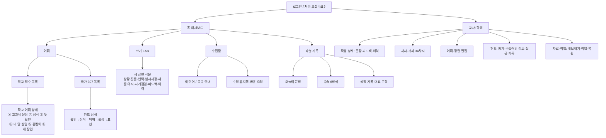

# 3. 전체 아키텍처 · 화면 구성

## 3-1. 아키텍처

```mermaid
flowchart LR
  subgraph 학생·교사 기기
    B[브라우저<br/>GitHub Pages 의 정적 화면<br/>HTML/CSS/JavaScript]
  end
  B -- "HTTPS POST (JSON)<br/>action + token + payload + req_id" --> W
  subgraph 선생님 구글 계정
    W[Apps Script 웹앱<br/>Code.gs: doPost] --> C[Core.gs<br/>인증·권한·저장 규칙]
    C --> S[Store.gs<br/>SheetsStore] --> G[(구글 시트<br/>표 19개)]
    C -. 잠금 .-> L[LockService]
  end
  B -. "정적 어휘 데이터<br/>vocab.json · cards.json" .-> P[(GitHub Pages)]
```

**같은 Core 를 두 곳에서 쓴다.**

```
backend/Core.gs ──(tools/sync_core.py)──> docs/js/core.js
      │                                         │
      ├─ Apps Script: 구글 시트 저장소            ├─ 체험 모드: 브라우저 메모리/localStorage 저장소
      └─ (같은 코드이므로 같은 규칙)              └─ 화면이 규칙(완료 기준 등)을 계산할 때도 사용
```

- 어휘·카드(읽기 전용 큰 데이터)는 **정적 JSON** 으로 화면에 바로 싣고, 서버에는 학생이 만든 기록과 교사가 고친 내용만 저장한다.
- 학생 화면은 로그인 직후 `sync` 한 번으로 **내 기록 전부**를 받아 오고, 이후 저장할 때만 서버로 보낸다.

## 3-2. 화면 구성도



## 3-3. 폴더·파일 구조

```
vocab-power-app/
├─ docs/                  GitHub Pages 가 서비스하는 화면 (정적 파일)
│  ├─ index.html          한 페이지 앱 (해시 주소로 화면 전환)
│  ├─ config.js           ★ 선생님이 고치는 유일한 설정(서버 주소)
│  ├─ css/app.css
│  ├─ data/               vocab.json (어휘·출처·관계·장면) · cards.json (국가 카드)
│  └─ js/
│     ├─ core.js · sha256.js     backend 의 복사본(자동)
│     ├─ api.js · data.js · ui.js · app.js
│     ├─ student.js · student2.js · teacher.js
│     └─ memory_store.js · demo_env.js · seed_examples.js   체험 모드 전용
├─ backend/               Apps Script 코드
│  ├─ Core.gs  Sha256.gs  Store.gs  Code.gs  Setup.gs  SeedExamples.gs
│  ├─ AppsScript_통합.gs  위 파일을 하나로 합친 것(붙여 넣기용, 자동 생성)
│  └─ appsscript.json     배포 설정(접근: 누구나, 실행: 나)
├─ data/                  원본 가공 데이터와 대조 보고서
│  ├─ school_scenarios.tsv · school_examples.tsv   자체 제작 장면·예시(초안)
│  ├─ national_cards.json                         PDF 에서 뽑은 원자료
│  └─ reports/대조_검증_보고서.md
├─ tools/                 데이터 만들기·검사·미리보기 스크립트(Python)
├─ tests/                 브라우저에서 여는 자동 테스트 2종 + 데이터 검사
├─ design/                이 설계 문서들
└─ guide/                 선생님용 배포·운영 안내
```
