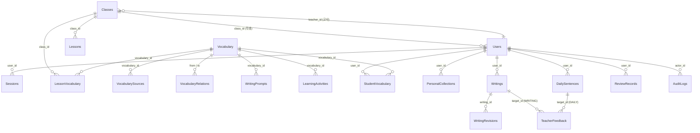

# 4. 데이터 모델 · ERD

표(시트) 19개. 열 제목 전체는 [04b_시트_열_제목.md](04b_시트_열_제목.md) (코드에서 자동 생성).

## 4-1. ERD

## 4-2. 설계 결정

- **표제어 · 출처 · 학습 기록을 분리**했다.
  - `Vocabulary` 는 «표제어 + 의미(sense)» 한 줄. 학교 103개(`V-S001…`)와 국가 307개(`V-N001…`)는 **서로 다른 줄**이다.
    같은 표제어(9개)도 병합하지 않고 `VocabularyRelations` 에 `SAME_HEADWORD / CANDIDATE`(교사 확인 전)로 이어 둔다.
  - `VocabularySources` 가 출처다. 학교 원본 **104개 항목**은 `original_entry_id`(예: `정리본#85-1`, `정리본#85-2`)로 보존하고,
    교과가 여러 개이거나 쪽수가 여럿이어도 **모두 한 줄씩** 둔다. 원본에 없는 출판사·쪽수는 지어내지 않고 «미기재» 로 둔다.
- **학생 데이터는 모두 `user_id` 로 소유**한다. 서버가 요청마다 토큰의 주인과 비교한다.
- **글(Writings)**: `draft_text`(쓰는 중) / `text`(마지막 제출본) / `version`(제출 횟수).
  제출할 때마다 `WritingRevisions` 에 한 줄이 쌓이고 지우지 않는다. 장면(교과·일상·세상)마다 따로 저장한다.
- **충돌 방지**: 학생이 고칠 수 있는 줄마다 `rev` 숫자가 있어 저장 때마다 +1 한다. 낡은 `rev` 로 저장하면 거절한다.
- **수집 단어**: 같은 낱말을 다른 문맥으로 또 저장하면 새 줄이 생기고 `duplicate_of` 로 첫 줄을 가리킨다. 공용 사전에 있으면 `vocabulary_id` 로 연결한다.

## 4-3. 키·인덱스·제약

구글 시트에는 DB 의 인덱스·외래키가 없으므로 **Core 가 대신 지킨다.**

| 종류 | 지키는 방법 |
|---|---|
| 기본키 유일성 | ID 는 `접두어 + 난수 8바이트`(예: `W-3fa9…`). 저장소가 첫 열로 색인을 만들어 조회 |
| 외래키 | 쓰기 전에 대상 존재·소유를 확인(예: `vocabExists`, `ownOr404`, `requireTeacherOfStudent`) |
| 유일 제약 | 한 학생×어휘×장면의 글은 하나(`writingFor`), 학급×번호 학생은 하나(`DUPLICATE`), 아이디는 전체에서 유일 |
| 인덱스 | 요청 한 번에 표를 한 번 읽어 메모리에 색인(`Store.gs`). 쓰기는 잠금 뒤 다시 읽어 일관성 유지 |
| 개수 제한 | 글 2,000자, 한 번에 학생 60명, 차시 어휘 60개 등 입력 크기 제한 |
